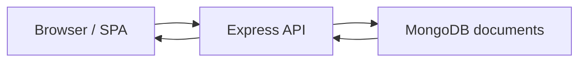

# CS-465 | Full-Stack Development Reflection

**A technical reflection on frontend, backend, database and security decisions in MEAN-stack coursework.**

[GitHub profile](https://github.com/xtyledan) · [TkForge runnable project](https://github.com/xtyledan/TkForge-Visual-Tkinter-GUI-Builder)

## Architecture studied

*Conceptual MEAN application data flow. No runnable implementation of this diagram is committed in this repository.*

## Purpose

CS-465 coursework explored the design of full-stack applications: browser interfaces, server-side routes, document databases, authentication concepts and API testing. This repository is the written reflection on that experience.

## Main topics

| Area | Learning and engineering decisions |
| --- | --- |
| Frontend | Server-rendered pages versus a client-side SPA |
| Backend | Express routes, JSON request/response models |
| Database | MongoDB's flexible documents, validation and indexing tradeoffs |
| Reliability | Reusable components, input checks and negative-path tests |
| Security | Authentication flows, password handling and unauthorized requests |

## How to review

Read this README as a portfolio reflection. There is no `package.json`, application source directory, deployment or automated test suite in this repository, so **there is no local application command**.

For examples of code and tests that *are* included in GitHub, inspect [TkForge](https://github.com/xtyledan/TkForge-Visual-Tkinter-GUI-Builder) or the [Animal Rescue Explorer](https://github.com/xtyledan/Animal-Rescue-Explorer-Local-Data-Dashboard).

## Technical tradeoffs

An SPA can reduce page reloads but increases client-side complexity. MongoDB maps naturally to JSON but still needs validation, index planning and access controls. API unit tests and integration tests answer different questions; claiming coverage requires the actual tests and results.

## Scope and next steps

**Only README.md is committed here.** No screenshot, working MEAN application, deployed demo or verified security result is available. If the original project source can be published with permission, add build steps, test automation and an authentic browser screenshot.

**Type:** Educational reflection, not a runnable project.
